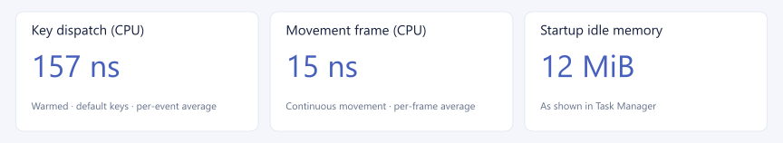

# KeySteer

<p align="center">
  
</p>

<p align="center"><strong>From clicks to split screens, put your workspace on your keyboard.</strong></p>

<h3 align="center">
  <a href="https://github.com/dccif/KeySteer/blob/main/README.md">简体中文</a> · <strong>English</strong>
</h3>

KeySteer brings native keyboard control to Windows and macOS. Move the pointer, type labels to target controls, split and tile windows, and save layouts for reuse.

[Download](https://github.com/dccif/KeySteer/releases/latest) · [Documentation](https://dccif.github.io/KeySteer/en/guide/getting-started) · [Try the simulator](https://dccif.github.io/KeySteer/en/editor/)

**Contents** · [Features](#features) · [Demos](#demos) · [Install](#installation) · [Get started](#get-started) · [Configure](#configuration) · [Performance](#performance) · [Develop](#development-and-packaging)

## Features

- **UI Hint recognition**: target labelled controls across displays and applications; search text or Chinese initials, copy information, and pick colours.
- **Normal pointer control**: Vim-style movement, clicks, scrolling, and dragging, with speed adjustment and display switching.
- **Grid, Recursive Grid & Bisect**: reach a region with two keys, subdivide it for precision, or halve it with `H/J/K/L`.
- **Window, Quick & Editor**: move, resize, split, and tile windows, with audio controls too.
- **Tabs & workspaces**: group windows into tabs and save layouts for reuse.
- **Appearance & configuration**: customise keys, speed, and styles, with previews in the web simulator.

<a id="video-demonstrations"></a>

## Demos

<details>
<summary>Pointer and interface targeting: Normal, Grid, Recursive Grid, Bisect, UI Hint</summary>

### Normal

https://github.com/user-attachments/assets/10c990c4-903c-49fb-b8d7-5441430d3496

### Grid

https://github.com/user-attachments/assets/4ecb749e-d770-43c1-907a-e55a4144a9ca

### Recursive Grid

https://github.com/user-attachments/assets/cb399755-5cde-40a0-ba64-d00c7e581cc6

### Bisect: half the distance, each time

https://github.com/user-attachments/assets/2c8a6d9f-d6c1-471e-9942-f9551f679790

### UI Hint

https://github.com/user-attachments/assets/71efcae3-eb11-46d0-aba4-0a5df5e9c80c

### UI Hint search: initials, copying, and color picking

https://github.com/user-attachments/assets/84d0872d-81f6-4e42-aa7f-767061cef646

</details>

<details>
<summary>Window management: moving, splits, tiling, tabs, and saving</summary>

### Window: control your workspace

https://github.com/user-attachments/assets/a1f38691-f6cf-45bf-b264-03a1a70cd104

### Quick: press A for split layouts

https://github.com/user-attachments/assets/e9a278cd-a05a-4931-80cc-d2f832142296

### Editor: press E to tile and fine-tune

https://github.com/user-attachments/assets/e21b68e3-f970-4e47-b5a2-fec80720b43b

### Tabs: group windows by application

https://github.com/user-attachments/assets/2c1b894d-7402-4b57-9fd1-da03f5bd81a9

### Save: keep layouts and tab groups

https://github.com/user-attachments/assets/9965dbb6-ed80-4071-b636-563563b83b7d

</details>

<details>
<summary>Key help and visual configuration</summary>

### key_help: keep available actions in view

https://github.com/user-attachments/assets/9c28c826-d465-4d47-b671-7a275c282a76

### Configuration & Simulator: edit on a full keyboard

https://github.com/user-attachments/assets/fbb5f750-fcda-4d3f-92da-1f7667387927

</details>

## Installation

Supports **Windows 10/11 (x64, ARM64)** and **macOS 14+ (Apple Silicon, Intel)**.

Download from [GitHub Releases](https://github.com/dccif/KeySteer/releases/latest): on Windows, extract and run `KeySteer.exe`; on macOS, move `KeySteer.app` to `/Applications` and follow the [permission guide](https://dccif.github.io/KeySteer/en/guide/macos). Windows x64 uses AVX2 by default; choose the compatible build for an older CPU.

**Windows (Scoop)**

```powershell
scoop bucket add keysteer https://github.com/dccif/KeySteer.git
scoop install keysteer/keysteer
```

**macOS (Homebrew)**

```bash
brew tap dccif/keysteer https://github.com/dccif/KeySteer.git
brew install --cask dccif/keysteer/keysteer
```

**First launch on macOS:** in **System Settings → Privacy & Security**, allow KeySteer under **Device Control and Data Access** or **Accessibility**. UI Hint visual recognition also needs screen recording permission. Restart the app after granting access.

If macOS blocks an app downloaded from the official Releases page, run:

```bash
sudo xattr -cr /Applications/KeySteer.app
```

## Get started

No configuration file is needed. See [Getting started](https://dccif.github.io/KeySteer/en/guide/getting-started) for controls and keys, and the [window management guide](https://dccif.github.io/KeySteer/en/window-management/) for layouts and tab groups.

## Configuration

Use the [web simulator](https://dccif.github.io/KeySteer/en/editor/) to customise keys and appearance, or edit TOML directly; see the [configuration reference](https://dccif.github.io/KeySteer/en/reference/configuration) for saving and loading.

## Performance

**Core processing in nanoseconds. A light memory footprint.**



(0.12.3 / Windows. Core CPU figures are batch averages per event/frame, excluding system input, recognition, and display work. [Full results and methods](https://dccif.github.io/KeySteer/en/performance).)

## Development and packaging

See the [development workflow](https://dccif.github.io/KeySteer/en/development/workflow) for running from source, tests, and packaging, and [Safety and performance](https://dccif.github.io/KeySteer/en/development/safety-and-performance) for measurement methods and constraints.

## License and copyright

Copyright © 2026 dccif. KeySteer is released under the **GNU General Public License v3.0 or later (GPL-3.0-or-later)**; see [LICENSE](https://github.com/dccif/KeySteer/blob/main/LICENSE) for the full text.
