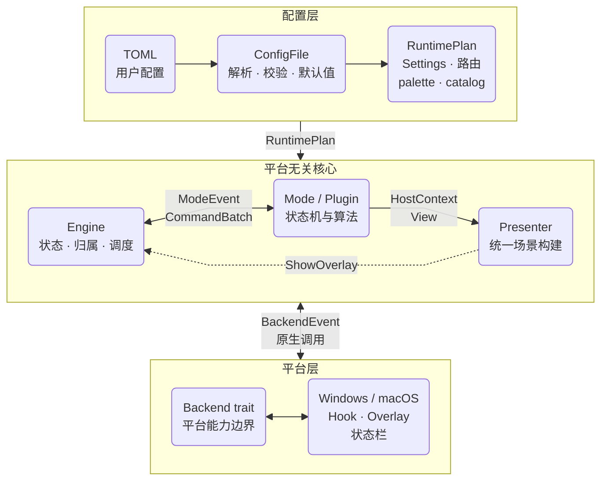
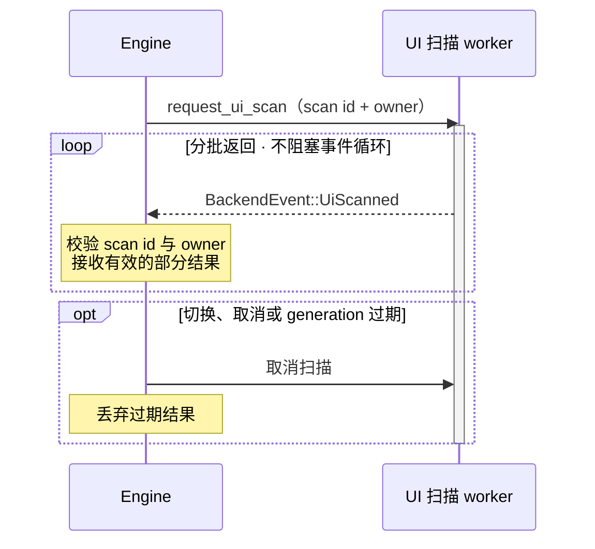

# 架构

读源码可以先抓住这条线：**配置决定按键，Mode 处理交互，Engine 调度命令，Backend 调用系统能力**。画面由 presentation 统一生成。项目使用一个 Rust crate。

::: tip 从哪里开始
只改键位看[配置文件](/reference/configuration)；准备加功能，先看下面的分层图，再读[扩展指南](/development/extension-guide)。
:::

## 架构总览



配置和 `Command` 向平台能力流动；键盘、指针、屏幕、帧时钟及异步扫描结果以 `BackendEvent` 返回 Engine。Mode 始终位于平台无关的一侧，只通过 `ModeEvent` 与 `Command` 和宿主交互。

## 源码分层

| 目录 | 负责什么 | 从哪里开始读 |
| --- | --- | --- |
| `src/api/` | 项目内共用的按键、命令、事件、视图和接口 | `api/mod.rs`、`api/binding.rs`、`api/command.rs` |
| `src/config/` | TOML 反序列化、默认值、校验、主题、继承和可提交 store | `config/mod.rs`、`config/store.rs` |
| `src/app/` | CLI、路径、配置编译、Mode catalog、runtime 和启动组装 | `app/bootstrap.rs`、`app/configuration.rs` |
| `src/app/runtime/` | 应用私有 Engine、RuntimePlan 与输入/调度/覆盖层协作者 | `app/runtime/mod.rs`、`app/runtime/plan.rs` |
| `src/modes/` | `idle`、`normal`、`grid`、`recursive_grid`、`ui_hint` 状态机 | 对应的 `.rs` 文件 |
| `src/modes/hint/` | UI Hint 标签分配、匹配和扫描状态 | `labeling.rs`、`matching.rs`、`session.rs` |
| `src/presentation/` | 统一构建模式、帮助面板和光标装饰场景；只依赖 api | `mod.rs`、`hint/`、`key_help.rs`、`dynamic.rs` |
| `src/plugins/` | 内置插件；也是插件的参考实现 | `builtin/screen_selector.rs` |
| `src/platform/windows/` | Win32 Hook、SendInput、UIA、覆盖层、帧时钟和托盘 | `mod.rs` |
| `src/platform/macos/` | CGEventTap、Core Graphics、AX、Vision、AppKit 和顶部状态项 | `mod.rs` |

`src/main.rs` 进入启动流程，`cfg(target_os)` 选择平台后端。`src/lib.rs` 只公开 `app`，其余模块在 crate 内共用；本地性能测试使用隔离适配，不增加生产 API 或基准 feature。

## 启动流程

`main.rs` 进入 `app::run_cli()` 后，程序依次：

1. 初始化日志和 panic hook。
2. 解析 `--config`、`--check`、`--doctor` 等参数。
3. 显式 `--config` 时加载该文件；否则在应用数据目录按文件名选择第一个 `keysteer.<名称>.toml` 用户配置。没有用户配置时读取 default 文件，再没有才用内置默认值。
4. 把已验证的 `ConfigFile` 编译成 `RuntimePlan`。
5. 创建目标平台的 `Backend`，并以完整计划创建 `Engine`。
6. 启动事件循环，默认激活 `idle`。

## Engine 是调度中心

Engine 负责把输入交给正确的模式，再执行模式返回的命令。

| 管理内容 | 相关类型 |
| --- | --- |
| 当前模式、临时模式、模式栈 | Mode |
| 模式按键和应用例外 | 编译后的绑定表 |
| 按键归属、长按、合成输入 | `InputState` |
| 动作序列、定时器、显示帧 | `Scheduler` |
| 屏幕、鼠标、前台应用、主题和画面 | 运行时状态 |

网格算法和扫描处理留在各自模块。Mode 请求能力，Engine 调用 Backend 或发送新的 ModeEvent；原生窗口句柄和权限不进入 Mode。

## Mode 与 Plugin 的统一契约

Mode 是一个平台无关状态机：收到 `ModeEvent` 和只读的 `HostContext`，返回 `CommandBatch`。

```rust
impl Mode for MyMode {
    fn id(&self) -> ModeId { ModeId::new("my_mode").unwrap() }

    fn handle(&mut self, event: &ModeEvent, ctx: &HostContext<'_>) -> CommandBatch {
        // 更新状态，返回宿主可以执行的 Command
        CommandBatch::new()
    }
}
```

显示画面时，Mode 调用 `ctx.present(View)`，Presenter 再生成标签和形状。新增视觉组件时，添加 API 视图和对应的画面组合代码；后端继续绘制现有图形。

Mode 可以请求：移动鼠标、发送按键、显示覆盖层、扫描 UI、切换或压栈模式、设置 timer、执行命令和重载配置。它不能直接调用 `Backend`、`Win32`、`AppKit`、`UIA` 或 `AX`。

插件也可以实现同一个 `Mode` trait，并通过 `Manifest` 声明 id、动词和建议绑定。

## 异步工作

UIA、AX、Vision 扫描在 worker 中执行，以 `BackendEvent::UiScanned` 分批返回；Engine 用 scan id 和 owner 丢弃过期结果。



## 修改时守住的边界

- 新能力先放进 `src/api/` 的平台无关类型，再由 Mode/Engine 使用。
- 不要让 Mode 依赖某个平台的具体类型。
- 修改 `Backend` 时同时检查 Windows、macOS 和 `unsupported` 实现。
- 改动绑定语法时同步更新 `keysteer.default.toml`、配置文档和测试。
- 改动 Finish、点击或 held input 时，重点检查失败清理和 key-up 路由。无效配置重载必须零副作用；有效重载执行完整 runtime restart，同时保留物理 Down/Up disposition 配对。

下一步可阅读 [扩展指南](/development/extension-guide)、[开发流程与测试](/development/workflow) 或 [插件开发](/development/plugin-development)。

## 窗口模式共享会话

五个窗口模式各自注册、配置和绑定，共用一份 `WindowSession`：

| 切换阶段 | 保留或处理什么 |
| --- | --- |
| Window／Quick／Editor／Restore／Tabs 之间切换 | 窗口清单、稳定编号、编辑事务和撤销记录 |
| `prepare_transition` | 先异步完成待提交的编辑，确认后切换并转移结果归属 |
| 离开整个窗口模式组 | 释放共享会话 |

Restore 成功后按 Finish 配置切换模式；删除是 Restore 内部状态，通过宿主存储接口核对并原子删除记录。Tabs 管理分组和模板。五个模式共用 presentation 的帮助面板。
