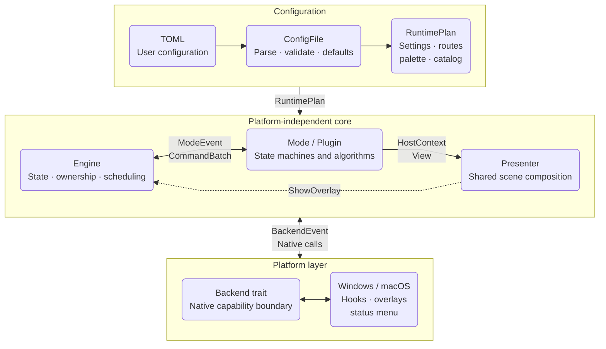
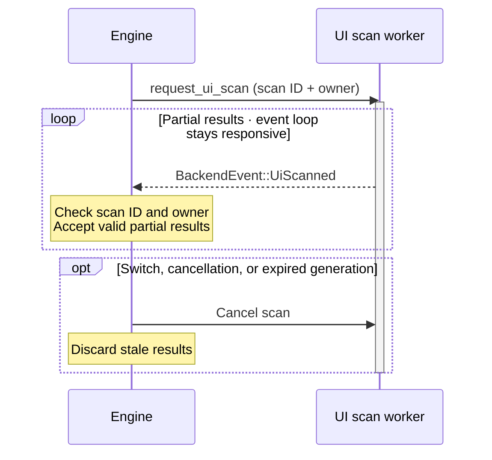

# Architecture

Start with one path: **configuration defines keys, Modes handle interactions, the Engine schedules commands, and the Backend calls the OS**. Presentation builds the visuals. The project uses one Rust crate.

::: tip Where to begin
For shortcuts, see [Configuration](/en/reference/configuration). To add a feature, read the diagram below, then the [Extension guide](/en/development/extension-guide).
:::

## Architecture overview



Commands flow toward native capabilities. Keyboard, pointer, display, frame-clock, and asynchronous scan events return to the Engine as `BackendEvent`. Modes stay on the platform-independent side and communicate through `ModeEvent`, `Command`, and `HostContext`.

## Source layers

| Directory | Responsibility | Start here |
| --- | --- | --- |
| `src/api/` | Shared keys, bindings, commands, events, overlays, plugin and backend traits | `api/mod.rs`, `api/binding.rs`, `api/command.rs` |
| `src/config/` | TOML parsing, defaults, validation, themes, inheritance, and configuration store | `config/mod.rs`, `config/store.rs` |
| `src/app/` | CLI, paths, configuration compilation, mode catalog, runtime, and startup | `app/bootstrap.rs`, `app/configuration.rs` |
| `src/app/runtime/` | Private Engine, RuntimePlan, input routing, scheduling, and overlay coordination | `app/runtime/mod.rs`, `app/runtime/plan.rs` |
| `src/modes/` | `idle`, `normal`, `grid`, `recursive_grid`, and `ui_hint` state machines | The corresponding `.rs` files |
| `src/modes/hint/` | UI Hint label assignment, matching, and scan state | `labeling.rs`, `matching.rs`, `session.rs` |
| `src/presentation/` | Mode, help-panel, and cursor scenes; depends only on the API | `mod.rs`, `hint/`, `key_help/`, `dynamic.rs` |
| `src/plugins/` | Bundled plugins and reference implementations | `screen_selector.rs` |
| `src/platform/windows/` | Win32 hooks, SendInput, UIA, overlays, frame clock, and tray | `mod.rs` |
| `src/platform/macos/` | CGEventTap, Core Graphics, AX, Vision, AppKit, and status item | `mod.rs` |

`src/main.rs` starts the app, and `cfg(target_os)` selects the backend. `src/lib.rs` exposes only `app`; other modules are shared within the crate. Local benchmarks use isolated adapters without adding production APIs or benchmark features.

## Startup flow

After `main.rs` calls `app::run_cli()`, the application:

1. Initializes logging and the panic hook.
2. Parses options such as `--config`, `--check`, and `--doctor`.
3. Loads an explicitly selected configuration, or selects the first `keysteer.<name>.toml` user file by filename in the application data directory. Without a user file, it reads the default file, then falls back to built-in defaults.
4. Compiles the validated `ConfigFile` into a `RuntimePlan`.
5. Creates the platform `Backend` and the `Engine` with the complete plan.
6. Starts the event loop in `idle`.

## The Engine coordinates work

The Engine routes input to the right mode and executes the commands it returns.

| Managed state | Related type |
| --- | --- |
| Current mode, temporary mode, mode stack | Mode |
| Mode keys and app exceptions | Compiled binding tables |
| Key ownership, holds, synthetic input | `InputState` |
| Action sequences, timers, display frames | `Scheduler` |
| Displays, pointer, focused app, theme, scene | Runtime state |

Grid algorithms and scan processing stay in their own modules. A Mode requests work; the Engine calls the Backend or sends another ModeEvent. Native window handles and permissions stay outside Modes.

## One contract for Modes and plugins

A Mode is a platform-independent state machine: it receives a `ModeEvent` and read-only `HostContext`, then returns a `CommandBatch`.

```rust
impl Mode for MyMode {
    fn id(&self) -> ModeId { ModeId::new("my_mode").unwrap() }

    fn handle(&mut self, event: &ModeEvent, ctx: &HostContext<'_>) -> CommandBatch {
        // Update state and return commands for the host.
        CommandBatch::new()
    }
}
```

For visuals, a Mode calls `ctx.present(View)` and the Presenter builds labels and shapes. Add an API view and matching composition code for a new visual component; backends continue drawing existing primitives.

Modes can request pointer movement, key injection, overlays, UI scans, mode switches, modal pushes, timers, external commands, and configuration reloads. They cannot call `Backend`, Win32, AppKit, UIA, or AX directly.

Plugins implement the same `Mode` trait and declare their ID, verbs, and suggested bindings in a `Manifest`.

## Asynchronous work

UIA, AX, and Vision scans run on workers and return partial results as `BackendEvent::UiScanned`. The Engine checks scan IDs and owners to discard stale results.



## Boundaries to preserve

- Define new capabilities with platform-independent types in `src/api/` before using them in Modes or the Engine.
- Keep platform-specific types out of Modes.
- Check Windows, macOS, and `unsupported` implementations when changing `Backend`.
- Update the default TOML, configuration docs, and tests together when changing binding syntax.
- When changing Finish, clicking, or held input, check failure cleanup and key-up routing. Invalid configuration reloads have no side effects; valid reloads restart the runtime while preserving physical Down/Up disposition pairs.

Continue with the [Extension guide](/en/development/extension-guide), [Workflow and tests](/en/development/workflow), or [Plugin development](/en/development/plugin-development).

## Shared window sessions

The five window modes register and configure independently while sharing a `WindowSession`:

| Transition | What happens |
| --- | --- |
| Between Window, Quick, Editor, Restore, and Tabs | Retain windows, stable numbers, edit transactions, and undo history |
| `prepare_transition` | Finalize pending edits asynchronously, then switch and transfer result ownership |
| Leave the whole window-mode group | Release the shared session |

Restore follows its Finish configuration on success. Deletion is a state inside Restore, using the host's storage interface to verify and atomically remove records. Tabs manages groups and templates. All five reuse presentation's help panel.
