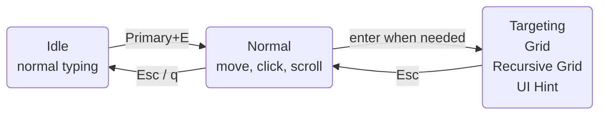
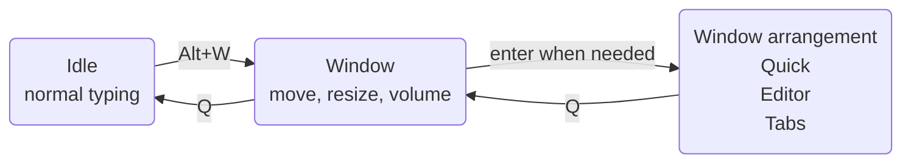

# Getting started

<script setup>
import ModeVideo from '../../.vitepress/components/ModeVideo'
import KeyLayout from '../../.vitepress/components/KeyLayout'
</script>

Give your mouse a short break. KeySteer lets you move, click, and arrange windows while your hands stay on the keyboard. Start with one click, then explore the tools you need.

::: tip Try it first; the key list can wait
Start with one click, then try moving a window. The full keyboard layout and configuration reference are farther down the page, ready when you need them.

No configuration file is needed. KeySteer waits in the tray or status bar until you activate it.
:::

## First use

1. Start KeySteer.
2. Press the entry key:

   | Windows | macOS |
   | --- | --- |
   | `Left Alt + E` | `Command + E` |

3. Hold these keys to move the pointer:

   ```text
          K  up
   H  left  J  down  L  right
   ```

4. Press `;` to left-click.
5. Press `Esc` to return to Idle and restore normal keyboard input.

Once you have moved the pointer and clicked once, you know KeySteer's most common workflow.

::: warning No response on your first macOS use?
Grant **Device Control and Data Access** permission on macOS 27, or **Accessibility** on older versions. See [macOS installation and permissions](/en/guide/macos).
:::

`Primary` means **Left Alt** on Windows and **Command** on macOS by default. Use Shift only when a shortcut explicitly includes `Shift+`.

## View available keys at any time

::: tip Your built-in cheat sheet
Press `?` (Shift+/) to see the current mode's keys; press it again to hide them. Learn each command when you need it.
:::

If you use a custom bindings table, keep `"?" = "key_help"` to retain this shortcut. The keyboard layout and quick reference are at the end of this page.

<ModeVideo file="help.mp4" title="Available key hints" description="Preview the panel, then bind key_help to a key of your choice." />

## Your first window adjustment

<ModeVideo file="window.mp4" title="Your first Window session" description="Move, resize, centre and control audio with the keyboard." />

1. Place the pointer over an ordinary window.
2. Press `Alt+W` (Option+W on macOS), then release the entry keys.
3. Use `H/J/K/L` to move it. Press `S` to switch to centred resizing, then use the same keys.
4. Press `Z` to undo an adjustment, or `Q` to finish and keep it.

Want a split screen? Press `A` from Window, then `H` for the left half. Want to arrange several windows? Press `E`; arrangement takes effect immediately and `Z` undoes it. `T` groups windows into tabs and `R` opens saved presets.

Quick, Editor, Tabs, and Restore use `Q` to return to Window; another `Q` returns to Idle. Hold `Primary` to temporarily use Normal pointer controls.

Follow the [Window guide](/en/window-management/) for side-by-side layouts, tab groups, saved workspaces, audio controls, and a mode-specific key reference.

::: tip A little room to experiment
`Z` undoes an adjustment and `Shift+Z` redoes it. Leaving with `Q` keeps the current layout.
:::

## Choose your next window task

| Key in Window | What happens | Learn more |
| --- | --- | --- |
| `A` | Choose placement and ratios with direction keys. | [Quick: fast split layouts](/en/window-management/quick) |
| `E` | Tile immediately; swap numbered windows and adjust regions. | [Editor: tile and edit regions](/en/window-management/editor) |
| `T` | Group compatible windows by application. | [Tabs: group windows](/en/window-management/tabs) |
| `R` | Save an arrangement, then fill it with the windows you need today. | [Restore: saved layouts and tab templates](/en/window-management/restore) |

Save from Editor or Tabs with `Ctrl+S` → optional note → `Enter`. An empty note uses an automatic name.

## The operating model at a glance



Most of the time you only switch between Idle and Normal. The three targeting modes are optional; there is no need to learn them all at once.



Window is the starting point for window management. Quick, Editor, and Tabs are optional ways to arrange your windows.

## When the pointer needs to travel farther

| What you want to do | Key | Mode |
| --- | --- | --- |
| Reach an approximate area quickly | `g` | [Grid](/en/modes/grid) |
| Target a very small control precisely | `Primary+G` | [Recursive Grid](/en/modes/recursive-grid) |
| Narrow the area with directional halves | `Primary+F` | [Bisect](/en/modes/bisect) |
| Select a button, link, or input directly | `f` | [UI Hint](/en/modes/ui-hint) |

Press `Esc` in a targeting mode to return to Normal; press it again to return to Idle.

## Want different keys?

Open the [Configuration & Simulator](/en/editor/) to view the keyboard, edit bindings and colours, then download your own TOML. KeySteer does not require a configuration file; start from the [shipped default](/generated/keysteer.default.toml).

`Primary` is a cross-platform name: it defaults to left `Alt` on Windows and `Command` on macOS. Advanced users can map it to another physical key with `[key_aliases]`.

::: info Common controls live in the status menu
Right-click the Windows tray icon or click the macOS status icon to pause, reload configuration, enable launch at login, check for updates, or quit. Choose **Configuration & Simulator...** to bring the active configuration into the web editor.
:::

Portable Windows builds keep configuration and logs beside the program. A macOS `.app` uses `~/Library/Application Support/KeySteer/`.

If something goes wrong, run diagnostics. After editing a configuration, you can check the file separately:

```bash
keysteer --doctor                       # Check the environment and permissions.
keysteer --check -c keysteer.user.toml   # Check configuration.
```

See [Configuration](/en/reference/configuration) for settings and troubleshooting, or [Modes and actions](/en/reference/modes-and-actions) for action syntax.

## Edit bindings in your browser

Open **Configuration & Simulator...** from the tray menu. It opens your browser and requires network access. The simulator is an editor and preview; native app behavior is authoritative.

<ModeVideo file="config.mp4" title="Edit W and A bindings" description="Choose a key on the full keyboard, then choose its action." />

## Everyday controls

<KeyLayout
  layout="q w e r t y u i o p/Caps a s d f g h j k l ; '/Shift z x c v b n m , . Slash RShift/Ctrl Primary Alt Space"
  move="h j k l"
  click="; ' RShift"
  speed="Caps Shift v b"
  scroll="m ,"
  state="n"
  navigation="t y u i"
  mode="e f g q Primary"
  label="Default key layout"
  hint="Learn the colour groups first, then add commands when you need them."
/>

| What you want to do | Key | Tip |
| --- | --- | --- |
| Move the pointer | `H / J / K / L` | Left / down / up / right |
| Precision / slow movement | `Caps Lock` / `Left Shift` | Hold while moving; also affects scrolling |
| Fast movement | `V` or `B` | Hold while moving; also affects scrolling |
| Scroll down / up | `M` / `,` | Scroll from the main key area |
| Left / right / middle click | `;` / `'` / `Right Shift` | Click keys sit near your right hand |
| Drag | `N` + a click key | Tap `N` alone to release |
| Home / End / Page Up / Page Down | `T / Y / I / U` | Send directly to the current application |
| Open a targeting mode | `G` / `F` / `Primary+G` / `Primary+F` | Grid / UI Hint / Recursive Grid / Bisect |
| Move the pointer to the next display | `Primary+S` | For multiple displays |
| Move the window under the pointer to the next display | `Primary+D` | Keep the pointer's relative position in the window |
| Return to Idle | `Q` or `Esc` | Resume normal typing |

See [Normal mode](/en/modes/normal) for dragging, speed controls, and remapping.
