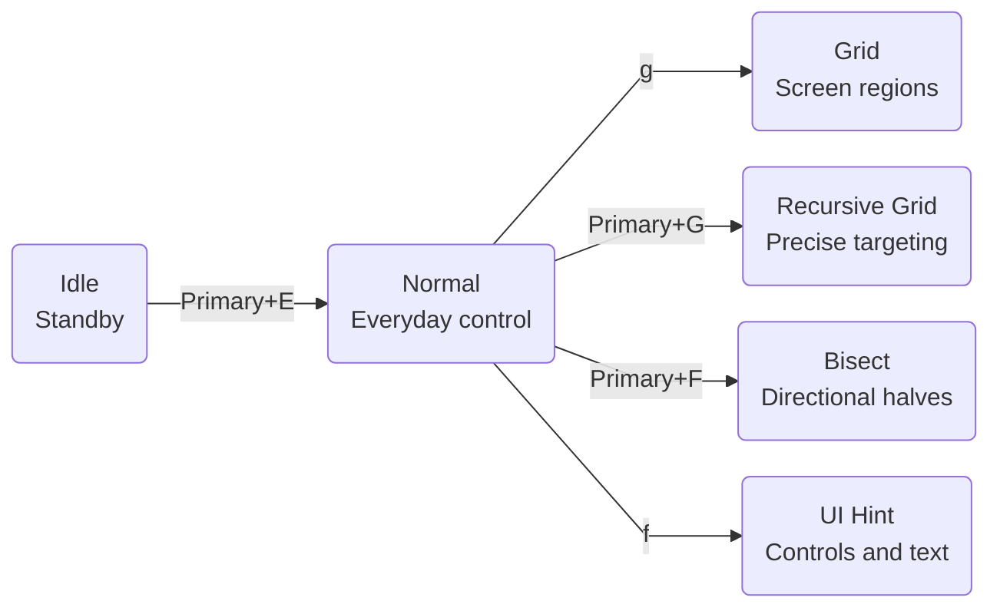

# Modes overview

Think of KeySteer as three operating layers: `Idle` waits quietly, `Normal` handles everyday movement and clicking, and a targeting mode helps you find an exact target.



All four targeting modes return to Normal with `Esc` or `Primary+Q`. In Normal, press `Esc` or `q` to return to Idle.

## Which mode should I choose?

| Your goal | Recommended mode | Why |
| --- | --- | --- |
| Move, scroll, click, or drag directly | [Normal](/en/modes/normal) | Best for everyday control. |
| Reach a screen area quickly | [Grid](/en/modes/grid) | Does not rely on application accessibility information. |
| Precisely target a small button or icon | [Recursive Grid](/en/modes/recursive-grid) | Keeps subdividing the current area. |
| Narrow with direction keys, without labels | [Bisect](/en/modes/bisect) | Halves only width or height per press. |
| Find a button, link, menu, or input | [UI Hint](/en/modes/ui-hint) | Labels controls from the accessibility tree or visual recognition. |
| Arrange windows, group tabs, or restore a workspace | [Window](/en/modes/window) | Move one window or build a reusable layout. |

## Idle: quiet waiting

Idle is the startup state. It listens only for entries in `[hotkeys]` and does not intercept normal typing. The usual entry is `Primary+E`: `Command+E` on macOS and `Alt+E` on Windows unless you override the `Primary` alias.

You can start any Mode directly from Idle:

```toml
[hotkeys]
"primary+e" = "normal"
"primary+g" = "grid"
```

Keep at least one entry key.

## Temporarily use Normal

Need a small pointer adjustment while targeting? Hold `Primary` to use Normal movement, scrolling, and clicks. Release it to continue selecting.

These are Grid's default settings. Recursive Grid, Bisect and UI Hint work the same way:

```toml
[grid]
inherits = ["hotkeys", "normal"]
temporary_mode = "normal"
temporary_mode_keys = ["primary"]
```

The temporary layer consumes its activation keys: `Primary+H` uses Normal's `H` movement binding. Explicit full chords in the current mode remain available, such as `Primary+Q` to return to Normal. See [Temporary input layers](/en/reference/configuration#temporary-input-layers) to change the modifier or resolve conflicts.

## End states

After locating a target, return to Normal or keep working in the selected area. Configure this with `lifecycle`:

```toml
[grid.lifecycle]
after_finish = "normal"
after_click = "finish"
```

| Field | When it applies |
| --- | --- |
| `after_finish` | The last grid level or a complete label finishes targeting |
| `after_click` | A click made through KeySteer succeeds; physical mouse clicks do not trigger it |

| Value | Effect |
| --- | --- |
| `keep` | Keep the mode and current selection |
| `restart` | Stay in the mode and start selecting again |
| Mode name, such as `normal` or `idle` | Switch to that mode |
| `finish` | Follow `after_finish`; only valid for `after_click` |
| `left_click` / `right_click` / `middle_click` / `double_click` | Click as soon as targeting finishes; only valid for `after_finish` |

::: info Default behavior
Grid and UI Hint return to Normal after locating or clicking. Recursive Grid and Bisect keep the current area so you can subdivide it further.
:::

## Multiple displays

Grid, Recursive Grid and Bisect target the display containing the pointer by default. The built-in Screen Selector plugin uses `Primary+S` to move to another display and can preserve the current targeting path.

## Important

::: warning Elevated windows may reject input
Windows Task Manager and other elevated windows may reject simulated input. When that happens, KeySteer releases its input state and returns to Idle.
:::
