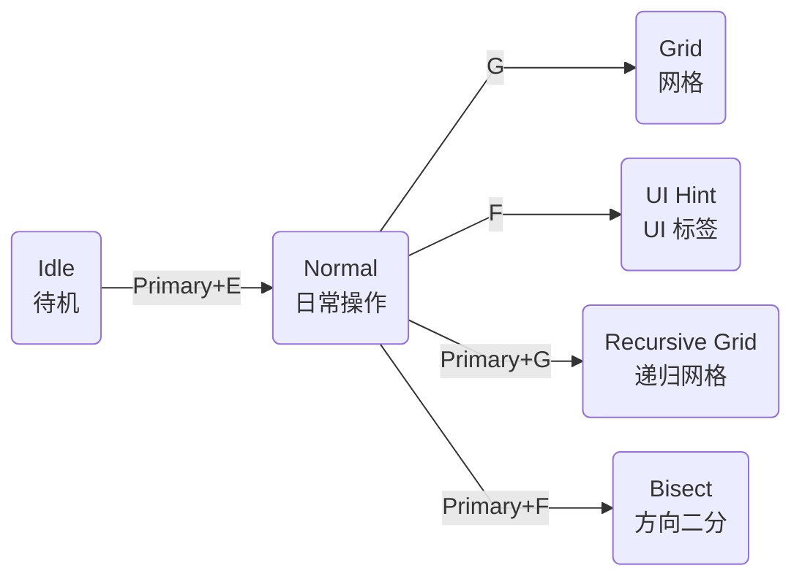

# 模式总览

把 KeySteer 想成三层操作：`Idle` 安静等待，`Normal` 负责日常移动和点击，需要找准目标时再进入一种定位模式。



四个定位模式都可以按 `Esc` 或 `Primary+Q` 回到 Normal；Normal 中按 `Esc` 或 `q` 返回 Idle。

## 选哪个模式？

| 你的目标                   | 推荐模式                                | 特点                                       |
| -------------------------- | --------------------------------------- | ------------------------------------------ |
| 直接移动、滚动、点击、拖拽 | [Normal](/modes/normal)                 | 适合日常操作。                           |
| 快速到达屏幕某个区域       | [Grid](/modes/grid)                     | 不依赖应用无障碍信息 |
| 精确到细小按钮或图标       | [Recursive Grid](/modes/recursive-grid) | 在当前区域反复细分           |
| 用方向键二分，不看字母 | [Bisect](/modes/bisect) | 每次只将宽或高减半 |
| 找按钮、链接、菜单、输入框 | [UI Hint](/modes/ui-hint)               | 根据可访问性树或视觉识别显示标签          |
| 移动分屏、组合标签、恢复工作区 | [Window](/modes/window) | 从单窗口调整到可复用的布局 |

## Idle：安静待机

Idle 是启动时的默认状态，只监听 `[hotkeys]` 中的入口，不会拦截普通文字输入。通常入口是 `Primary+E`：macOS 为 `Command+E`，Windows 为 `Alt+E`；如果配置覆盖了 `Primary` 别名，则以你的配置为准。

可以从 Idle 直接启动任意 Mode：

```toml
[hotkeys]
"primary+e" = "normal"
"primary+g" = "grid"
```

建议至少保留一个入口键。

## 临时使用 Normal

定位时还想挪一下鼠标？按住 `Primary`，就能用 Normal 的移动、滚动和点击键；松开后继续选目标。

下面是 Grid 的默认设置，Recursive Grid、Bisect 和 UI Hint 也采用相同方式：

```toml
[grid]
inherits = ["hotkeys", "normal"]
temporary_mode = "normal"
temporary_mode_keys = ["primary"]
```

临时层消耗激活键，例如 `Primary+H` 使用 Normal 的 `H` 移动。当前模式显式配置的完整组合键仍保留，例如 `Primary+Q` 返回 Normal。需要改临时键或处理冲突时，见 [临时模式按键优先级](/reference/configuration#临时模式按键优先级)。

## 模式结束状态

定位完成后，是返回 Normal，还是留在当前区域？用 `lifecycle` 设置：

```toml
[grid.lifecycle]
after_finish = "normal"
after_click = "finish"
```

| 字段 | 什么时候生效 |
| --- | --- |
| `after_finish` | 选到最后一层或完整标签，定位完成时 |
| `after_click` | 通过 KeySteer 完成一次点击后；物理鼠标点击不触发 |

| 值 | 效果 |
| --- | --- |
| `keep` | 留在当前模式，保留选择 |
| `restart` | 留在当前模式，从头选择 |
| 模式名，如 `normal`、`idle` | 切换到该模式 |
| `finish` | 按 `after_finish` 处理；只用于 `after_click` |
| `left_click` / `right_click` / `middle_click` / `double_click` | 定位完成后直接点击；只用于 `after_finish` |

::: info 默认结束方式
Grid 和 UI Hint 定位或点击后回到 Normal；Recursive Grid 与 Bisect 保留当前区域，方便继续细分。
:::

## 多显示器

`Grid`、`Recursive Grid` 与 `Bisect` 默认定位鼠标所在的显示器。

内置插件 Screen Selector 默认按键 `Primary+S` 可以切换到其他显示器，并可选择是否保留`Grid`、`Recursive Grid`、`Bisect` 当前定位。

## 特别注意

::: warning 高权限窗口可能无法操作
Windows 的任务管理器等高权限窗口可能拒绝模拟输入。发生这种情况时，KeySteer 会释放输入并回到 Idle。
:::
